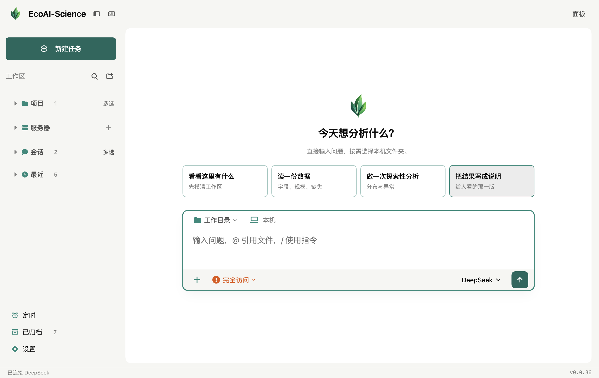

<div align="center">


# EcoAI-Science

**面向生态学研究的本地 AI-Agent 工作台**

**简体中文** · [English](README.en.md)

把研究问题、数据、R / Python、文献与分析结果连接在同一个工作空间。

[下载 v0.0.2](https://github.com/Jiawang1209/EcoAI-Science/releases/tag/v0.0.2) · [从源码运行](#从源码运行) · [使用文档](#使用文档) · [DAWN-Science](https://github.com/Jiawang1209/DAWN-Science)

</div>



## EcoAI 是什么

EcoAI-Science（简称 EcoAI）是一款面向生态学研究的本地 AI-Agent 工作台。它把自然语言对话、代码执行、Notebook、文件管理、文献阅读和结果交付放在一个桌面应用中，帮助研究人员从“我想研究什么”，走到“结果是怎样得到的”。

你可以与 Agent 讨论分析思路，让它在本地或 SSH 服务器上使用 R / Python 处理数据、绘图和运行脚本，也可以随时打开代码、查看输出、接管终端，并整理可供合作者检查和重跑的文件。

**EcoAI 借鉴并基于 DAWN-Science 的代码与设计发展，是 DAWN-Science 的姐妹产品。** 两者共享科研工作台的技术基础；EcoAI 聚焦生态学研究场景，围绕生态数据分析、科研绘图、文献证据与分析交付组织使用体验。项目保留原有开发历史与来源记录。

## 为什么选择 EcoAI

- **围绕研究过程工作。** 问题讨论、分析方案、实际计算、结果查看和文件交付在同一工作区衔接，减少在聊天工具、脚本编辑器和文件夹之间来回切换。
- **R 与 Python 共处一个工作台。** 使用你配置的解释器和 Jupyter 内核，连续执行代码、保留运行中的变量，并通过 Notebook 查看和手动运行代码单元。
- **本地优先，数据由你管理。** 项目对应自己的文件夹，会话、设置和执行记录存放在本机；服务器文件通过 SSH 管理。使用在线模型或科研检索时，相关请求仍会发送到所选服务。
- **过程可以检查。** 对话中能看到工具调用、代码、运行输出和生成文件；已有文件变更观察、执行记录与独立交付验证，便于发现问题和复查结果。
- **模型与工具可以选择。** 可配置不同模型服务，也能接入已有的 Claude Code / Codex 等外部运行时，并按需要启用 MCP、技能和工具插件。MCP 支持结果保留、独立取消和响应续传，详见[调用与连接恢复](docs/mcp.md)。

## 可以做什么

| 能力 | 你可以怎样使用 |
|---|---|
| 分析讨论与方案 | 围绕研究设计、变量、样本与统计方法讨论，使用“先出方案”在执行前审阅分析步骤 |
| R / Python 数据分析 | 读取表格、整理数据、执行统计与建模代码，查看输出，并继续使用同一运行中内核 |
| 科研绘图 | 用自己的数据生成图表，查看图片和脚本；可通过配置的 MLAI-science 案例库寻找绘图与分析参考 |
| Notebook 与终端 | 查看代码单元、手动执行、导出 Notebook；在原 Shell 与 EcoAI Agent 模式之间切换 |
| SSH 科研工作区 | 连接服务器，管理远端文件、运行命令、使用已安装的解释器，并上传或下载文件与目录 |
| 文献检索 | 通过 OpenAlex / Crossref 检索题录、核对 DOI 元数据，保存实际查询到的文献清单 |
| 多篇论文对照 | 阅读可提取文字的 PDF，记录物理页码和短摘，对照设计、样本量、方法与结论，整理 Excel 和 Markdown |
| 公开科研数据查询 | 通过 GEO、NCBI SRA、UniProt 查询记录、核验编号并保存清单；UniProt 支持所选记录的 FASTA 保存 |
| 成果来源与版本保留 | 查看已记录的代码、输入声明及环境；保留选定结果的固定副本，原文件变化后仍可查看旧版本 |
| 分析结果交付 | 从整个项目或留存版本显式选文件，沿用分步脚本生成分析报告与调用说明；可另行启动独立进程验证 |
| Office 与文件预览 | 使用 Word、Excel、PowerPoint、PDF 工具，预览 Markdown 相对图片与脚本链接、表格、PDF 和其他工作文件 |
| 工作台状态与导航 | 切换最近或默认目录，直接打开终端，查看当前模型、R/Python、已启用扩展及快捷键速查 |
| 多 Agent 与专业 Bot | 使用内置专业角色、子任务和团队协作，让不同助手参与分析、代码与科研审查 |
| 技能、记忆与连接器 | 管理可复用技能，搜索、预览并按固定提交安装[公开 GitHub 技能](docs/skills.md)，确认长期记忆，接入 MCP 服务和浏览器工具 |
| 定时任务与远程助理 | 在应用运行期间按计划启动任务；按需配置微信 / 飞书通道查看进展并继续交流 |

生态学研究中，EcoAI 可协助整理样方和观测表格、探索环境梯度与响应变量、编写群落或多样性分析代码、制作科研图表，以及比较论文中的研究设计。具体方法由研究问题、数据条件与所配置的 R / Python 软件包决定。

## 一个典型的研究过程

1. **打开项目文件夹。** 保留原始数据，用 `@` 引用相关表格、脚本或研究材料。
2. **说明研究问题。** 告诉 EcoAI 研究对象、变量、重复单位与希望获得的结果；需要时先生成方案。
3. **执行与查看。** 在已配置的 R / Python 内核或服务器中运行代码，检查日志、图表、Notebook 与实际文件。
4. **调整与复核。** 修改分析步骤、接管终端或手动运行代码，核对统计前提与结果解释。
5. **整理交付。** 导出脚本和说明，对所选结果进行独立验证，留下便于自己或合作者继续工作的材料。

例如：

> 先阅读这个样方数据表，说明缺失值、采样层级和重复单位。围绕群落组成与环境梯度的关系提出分析方案，等我确认后再运行。

> 比较这几篇论文的实验设计、独立样本量和主要结论。每项事实注明 PDF 页码，缺失的信息不要补猜，最后整理成论文对照表。

## 安装与准备

从 [EcoAI-Science Releases](https://github.com/Jiawang1209/EcoAI-Science/releases) 查看可用安装包。项目处于 **0.0.x 早期开发阶段**，具体平台和架构以当次发布附件为准。

| 平台 | 安装方式与当前边界 |
|---|---|
| macOS | 打开 `.dmg`，拖入 Applications。当前使用 ad-hoc 签名，尚无 Developer ID 公证；首次打开可能需要在“隐私与安全性”中允许 |
| Windows | 使用安装器或便携版；可能出现 SmartScreen 提示。仍需 Windows 真机验收，不能把生成安装包等同于已验证兼容 |
| Linux | 使用对应架构的 AppImage 或 `.deb`；具体系统依赖见[打包与发布](docs/打包与发布.md) |

首次启动通过四张居中卡片依次介绍 EcoAI、主要功能、API 连接和可选的 Python/R 计算环境，背景工作台虚化。向导可切换中文或 English，并沿用到工作台。默认选择 DeepSeek；切换服务商自动填入目录地址，也可手填 URL、模型和协议，并在保存前测试连通。解释器可检测或手填路径，配置失败在卡片内提示；两项配置都可稍后到设置中补充。已完成或跳过设置的用户不会重复看到介绍。

First launch introduces EcoAI through four centered cards: welcome, features, AI connection, and optional Python/R setup. Choose 中文 or English; the workbench keeps that preference. Provider URLs fill automatically, custom endpoints support model and protocol selection, and you can test connectivity before saving. Interpreter setup is optional, with errors shown in the guide. Both configurations can be completed later in Settings.

桌面安装包自带应用运行时，日常使用不要求另装 Node.js。按功能准备外部环境：

| 使用场景 | 需要准备 |
|---|---|
| 模型对话 | 在首次设置或设置页选择模型服务并填写相应凭证 |
| Python 计算 | Python 3、`ipykernel`，以及研究所需的软件包 |
| R 计算 | R、`IRkernel`，以及研究所需的软件包 |
| SSH 工作区 | 服务器 SSH 访问权限；运行 Python / R 时，服务器仍需相应解释器、内核与软件包 |
| 外部 Agent | 对应 CLI 或 ACP 适配器及其自己的认证配置 |
| 案例检索 | 单独配置 MLAI-science MCP 服务 |

## 从源码运行

需要 Node.js ≥ 22 与 npm。Linux 上部分原生模块还需要编译工具和 Python，详见[打包文档](docs/打包与发布.md)。

```bash
git clone https://github.com/Jiawang1209/EcoAI-Science.git
cd EcoAI-Science
npm ci
npm run app
```

首次启动可在界面中配置模型与解释器，无需先把真实凭证写进仓库。

常用开发命令：

```bash
npm run dev:mock       # 隔离数据目录，真实应用链路与确定性模型替身
npm run typecheck     # 类型检查
npm test              # 单元与集成测试
npm run build         # 构建桌面主进程、CLI 与界面
npm run test:e2e      # 构建后运行 Electron 测试
npm run dist          # 为当前平台打包到 release/
```

命令行 Agent：

```bash
npm run build:cli
./bin/ecoai --help
./bin/ecoai
```

为兼容已有项目，内部协议、`.dawn` 工作区目录、`DAWN_*` 环境变量和原 `dawn` 命令别名继续保留。打包版沿用既有数据目录，品牌替换不会自动搬移或清理历史会话与配置。CLI 配置方式见 [CLI 文档](docs/CLI.md)。

## 能力边界

- **本地工作台不代表离线模型。** 是否联网取决于你选择的模型、检索服务和工具；发送给服务的内容取决于当前任务与工具调用。
- **内核保持运行时，变量可以跨代码单元和会话使用。** 应用退出、内核退出或机器重启后，不承诺自动恢复内存中的变量。
- **工具权限控制不等同于操作系统沙箱。** 执行范围仍需要结合工作目录、账户权限和实际工具判断。
- **API、外部 CLI 和 ACP 的能力不同。** 内置科研插件不会自动为外部运行时增加同样的工具。
- **文献索引不等于全文证据。** 扫描 PDF 不承诺 OCR；元数据查询也不等于已下载或分析原始科研数据。
- **测试、来源记录与科学正确性分别判断。** 已保存副本及来源记录只证明其记录范围，完整输入/变量依赖仍可能缺失；代码成功运行或文件通过比较，不能替代研究者对实验设计、统计方法与结论的审查。

## 使用文档

| 文档 | 内容 |
|---|---|
| [产物来源与留存](docs/产物来源与留存-怎么用.md) | 保留结果版本、查看来源、Markdown 与分步脚本交付 |
| [文献调研](docs/文献调研-怎么用.md) | 多论文精读、证据与对照表 |
| [科研文献](docs/科研文献-怎么用.md) | OpenAlex / Crossref 检索与清单保存 |
| [科研数据](docs/科研数据-怎么用.md) | GEO / SRA / UniProt 查询与保存 |
| [案例与绘图](docs/照着文献画图-怎么装.md) | 配置 MLAI-science 案例检索 |
| [CLI](docs/CLI.md) | 命令行 Agent、配置与历史恢复 |
| [打包与发布](docs/打包与发布.md) | 安装包、平台依赖与发布流程 |
| [项目约定](CLAUDE.md) | 开发入口与验证规则 |
| [开发历史](docs/DEVELOPMENT_HISTORY.md) | 功能变更与验证记录 |

部分历史文档沿用 DAWN 名称，保留其原始设计与开发背景；当前项目与完整品牌名称为 EcoAI-Science，简称 EcoAI。

## Logo 与品牌资源

本项目使用作者提供、经细化后适配应用的 EcoAI 三叶 Logo。完整标识保留三片绿叶、金色弧线和 EcoAI 字样；App 内的小尺寸图标使用三叶标识，顶栏显示完整名称 **EcoAI-Science**。

[完整 Logo（透明 PNG）](packaging/brand/ecoai-logo.png) · [三叶标识（透明 PNG）](packaging/brand/ecoai-mark.png) · [App 图标](packaging/icon.png) · [资源来源与生成说明](packaging/brand/README.md)

## 技术基础与致谢

EcoAI 采用 TypeScript / Node.js、Electron、React / Vite、SQLite、Jupyter 协议、SSH 与 MCP 构建。模型和 Agent 能力建立在 `pi` 运行依赖之上。

感谢 [DAWN-Science](https://github.com/Jiawang1209/DAWN-Science) 提供代码与设计基础。EcoAI 作为其面向生态学研究的姐妹产品，继续保留来源、原有贡献与开发历史。其他设计参考见 [参考项目说明](docs/REFERENCES.md)。

## 许可证

[AGPL-3.0-or-later](LICENSE)。使用、修改和分发时，请保留原有版权、许可证与来源说明，并遵守相应开源义务。
